# End-to-end integration report

Branch `feat/integration`. Nothing is committed or pushed. All data used is synthetic (Synthea).

## What runs end to end

```mermaid
flowchart LR
  A[Upload Synthea CSV zip] --> B[Ingestion, all five stages<br/>called as is]
  B --> C[team_schema_loader: persisted FHIR to the lead's clinical tables]
  C --> D[Measure engine fqm-execution<br/>engine CLI and helpers]
  D --> E[measure_result, care_gap, care_gap_detail]
  E --> F[Gap prioritization score_all]
  F --> G[Work list and stars<br/>star rating code]
  G --> H[Upload a document: intake and OCR]
  H --> I[AI evidence extraction: proposed only]
  I --> J[Reviewer approves or rejects]
  J --> F
```



All five ingestion stages now run, then ours: csv_input, mapping, fhir_generation and validation in
`run_conversion`, then postgresql_storage in `run_persist_stage` (what the Persist Resources button runs). Only the
resources the persist stage approved are loaded.

One app, `python -m services.integration.app`, on http://localhost:8780 (127.0.0.1 only). The page has two tabs:
**Upload** (the Synthea zip, with live step progress) and **Work list** (measure cards with stars, the ranked gaps,
and per gap: score breakdown, documents with upload, "Find evidence with AI", and Approve or Reject on each
proposed finding).

## How to run it

```
powershell -ExecutionPolicy Bypass -File scripts/run_demo.ps1 -Integration -Setup   # first time
powershell -ExecutionPolicy Bypass -File scripts/run_demo.ps1 -Integration          # every other time
powershell -ExecutionPolicy Bypass -File scripts/run_demo.ps1 -Integration -Schema check20 -Setup `
    -EvidenceDir D:\HEDIS_Synthea_20\evidence                                          # with stored evidence
```

- `-EvidenceDir` sets `INTEGRATION_EVIDENCE_DIR` for the app process; without it the attach step is skipped and
  the batch counts say so. `INTEGRATION_PORT` changes the port (default 8780).
- If `.env` has no `EXTRACTION_MODEL` (and none is set in the shell), the launcher warns in yellow that the code
  default model is used and that `minimax/minimax-m3.1-flash:free` is the tested model.

- It uses the database in `.env`, but its own schema (`-Schema`, default `integ`). The launcher sets
  `DATABASE_URL` for its own process only, adding `options=-csearch_path=integ`; `.env` is not changed and the
  URL is never printed. `public` (the demo data used by the pages on 8765 and 8771) is not touched.
- `-Setup` creates the schema, runs `alembic -c db/alembic.ini upgrade head`, loads reference data only
  (`load_seed.py --reference-only`, skipped if already loaded) and builds the measure engine (Node 20).
- Then open http://localhost:8780, Upload tab, choose the zip of Synthea CSV files.

## Files added

| File | Purpose |
|---|---|
| `db/migrations/versions/0004_integration.py` | The ingestion service's tables (`conversion_jobs`, `fhir_resources`, `validation_issues`, exactly as its SQLAlchemy models), `batch_run` (one row per uploaded batch: status, step, counts, error) and the review states `closed_pending_engine` and `excluded_pending_engine` on `care_gap_detail`. The downgrade maps both back to `pending_review`. Tested downgrade to base and upgrade to head. |
| `services/integration/config.py` | Settings: actor, reviewer name, measurement year 2026, engine path, chunk size, work folder, port 8780. |
| `services/integration/pipeline.py` | Background runner for one batch: converting, persisting, loading, measuring, prioritizing. Updates `batch_run` and writes a `domain_event` and audit event per step; a failure is stored with its step and first error line. |
| `services/data_ingestion/team_schema_loader.py` | New file next to the ingestion service (none of its files changed). Set-based SQL from the persisted, non-rejected rows of `fhir_resources` into `fhir_resource_raw`, `patient`, `coverage`, `encounter`, `condition`, `observation` and `procedure`. Idempotent (a second run inserts nothing). |
| `services/integration/measures.py` | Writes a FHIR bundle per patient, runs the engine for BCS-E, COL-E, EED, GSD, KED and CBP in chunks, checks every patient came back, then writes `engine_runs`, `measure_result`, `care_gap` and `care_gap_detail`, and closes gaps the run shows met or excluded. |
| `services/integration/work.py` | Measure cards (rate, star, projected rate and star with confirmed closures and exclusions), the work list, one gap with its score breakdown, documents and evidence. |
| `services/integration/documents.py` | Sends one document for a patient through the intake service (`receive_file`, as the intake CLI does); used by the attach step. |
| `services/integration/evidence.py` | AI extraction for a gap (prompt builder, OpenRouter client, validator), kept findings saved as `proposed`; reviewer decisions; re-score after each. |
| `services/integration/app.py` | FastAPI app and routes. |
| `services/integration/static/index.html` | The page: a copy of `scripts/demo_priority/index.html` with the Upload tab, document upload and Approve or Reject added. |
| `docs/integration/END_TO_END_REPORT.md` | This report. |

## Changes to existing files

| File | Change | Why |
|---|---|---|
| `scripts/db/load_seed.py` | New `--reference-only` flag: loads the batch, organizations, practitioners, measures and star data; skips patients, results, gaps and documents. Default behaviour unchanged. | The integration schema needs measure rules and cut points but its patients come from the upload. |
| `scripts/run_demo.ps1` | New `-Integration` (and `-Schema`) switch. Without it, behaviour is unchanged. | One command to set up and start the integration app. |
| `.gitignore` | Adds `.integration_work/`. | Temporary engine bundles and uploads. |

**No changes to the ingestion or star rating code, to the lead's tables, or to the measure engine.** Their functions are
imported and called as they are, including some private helpers:

- Ingestion (`services/data_ingestion/app`): `api.upload_dataset_zip`, `pipeline.job_manager.create_job`,
  `pipeline.run_conversion`, `pipeline.run_persist_stage`, `db.session_scope`, `models.ConversionJob`; for the
  engine call, `api._extract_root_library_reference`, `api._maybe_prune_run_request_bundle` and
  `api._to_member_result`.
  A rename of these private helpers would break the integration; making them public would be a good follow-up.
- Star rating (`common/star_rating`): `assign_star_rating` and `FinalizedMeasureResult`.
- Our own services: document intake, evidence extraction, gap prioritization.

Note: running the root script `npm run backend:install` (`npm --prefix services/measure_calc/engine install`) makes
npm add the repo root to the engine's `package.json` as a dependency and creates a junction to the repo root in
`node_modules`. I restored both package files and removed the junction; the launcher runs `npm install` inside the
engine folder instead. The team may want to fix the root script.

## Fix round (second review)

| # | Problem | Fix |
|---|---|---|
| 1 | The integration skipped the ingestion postgresql_storage stage (its job showed `resources_persisted` 0) and loaded every row. | `pipeline.py` calls the ingestion `run_persist_stage(job_id)` after `run_conversion` (step "persisting", event `batch.persisted` between `batch.converted` and `batch.loaded`, count stored as `persisted`). The loader moved to `services/data_ingestion/team_schema_loader.py` and reads only rows with `persisted = true` and `lifecycle_status <> 'rejected'`, for every table. The step fails with its counts if the stage raises or persists nothing, and loading fails if the job's `resources_persisted` differs from the stage's count or if patients loaded differ from persisted Patient resources. |
| 2 | GSD ran backwards: the GSD numerator is POOR control (last A1c above 9.0, an A1c without a result, or no A1c in the year), although the bundle says improvementNotation "increase". | `INVERSE_MEASURES = {"GSD"}` in `measures.py`: we store met = in denominator and not in the numerator, and a gap is the numerator and not excluded. Gap text: "Glycemic Status Assessment: most recent A1c above 9.0, or no A1c result in 2026". GSD rows carry " / numerator inverted (engine counts poor control)" in `engine_version`. The files are not changed. |
| 3 | CBP could never be met: the CBP library reads blood pressure only from combined readings (US Core blood pressure profile, systolic 8480-6 and diastolic 8462-4 as components), and the mapping writes two separate Observations with `valueQuantity`. | See "CBP engine file" below. |
| 4 | An approved exclusion counted as a closure. | New review state `excluded_pending_engine` (migration 0004, downgrade maps it to `pending_review`). On confirm, a proposal whose `evidence_kind` is `exclusion` sets `excluded_pending_engine`, anything else `closed_pending_engine`; if a gap has both kinds confirmed, the exclusion wins. Both leave the work list. Projected rate: numerator plus `closed_pending_engine`, denominator minus `excluded_pending_engine`; the measure card shows both counts. |
| 5 | `GET /api/batches/latest` was not one of the 9 agreed endpoints. | Removed. The page keeps the last batch id in localStorage (every read and write in try/catch; the page works without it) and polls `GET /api/batches/{id}`. |
| 6 | A gap never closed when a later run showed the care done (fixed gap ids, inserts skip existing gaps). | After writing results, `measures.py` sets each still open gap of this run's patients and measure whose new result is met (or excluded) to `care_gap.status = 'closed'`, `closed_at = now()`, and `care_gap_detail.review_status = 'closed'` (or `'excluded'`), with one audit event `gap.closed_by_engine` (actor `integration`) per gap and a `gaps_closed_by_engine` count on the batch. This is how `closed_pending_engine` and `excluded_pending_engine` become final when the engine agrees. Row values only, no schema change. |

### CBP engine file

For CBP only, each per-patient bundle file sent to the engine is changed before the pruning runs:

- **Added:** for each systolic (8480-6) and diastolic (8462-4) Observation pair of the same patient with the same
  `effectiveDateTime` and the same encounter, one combined Observation: code LOINC 85354-9 "Blood pressure panel
  with all children optional", `meta.profile` US Core blood pressure, status final, category vital-signs, the same
  subject, encounter and time, and two components (8480-6 and 8462-4) with their values in mm[Hg] (UCUM). Its id
  is a uuid5 of the two source ids.
- **Left out:** the separate systolic and diastolic Observations themselves, in the CBP engine file only. With them
  in the file the CBP query crashes ("Cannot read properties of null (reading 'isQuantity')" in the lowest reading
  sort, CQL lines 93 to 99): the engine runs with `--trust-meta-profile false`, so it treats them as blood pressure
  readings without components. Trial on the 33 non-excluded CBP denominator patients: with them, the engine call
  fails; without them, 23 of 33 met. A reading without a partner at the same time and encounter is left out too.
- **Unchanged:** they stay in `fhir_resources`, `fhir_resource_raw` and `observation`, and in the bundles for the
  other five measures. The combined readings are never written to any table.
- The pruning (`_maybe_prune_run_request_bundle`) then runs as it is and keeps every combined reading (code
  85354-9 is in the BP code list); the step fails if it ever removes one.

This should be revisited when the ingestion mapping writes combined blood pressure readings itself.

### Fixes found during the round

- **Upload commit:** `POST /api/documents` returned before its transaction was committed (FastAPI runs the
  connection dependency's cleanup after the response is sent), so an extraction requested straight after an upload
  could find no pages. The endpoint now commits before it returns.
- **Engine output:** an engine call that exits 0 but prints no JSON now fails the step with the engine's first error
  line, instead of a bare JSON error.

## Database decision

`.env` points at schema `public`, which holds the demo seed data at migration 0003. To avoid mixing uploaded
patients with the seed patients, I created schema `integ` (only `CREATE SCHEMA`) and ran the migrations there
through `db/alembic.ini`. `public` and `.env` were not changed. To run the app against another schema, pass
`-Schema name`.

## Rules kept

- The model only proposes: extraction saves `proposed` evidence. Only a person's Approve sets the gap to
  `closed_pending_engine` or `excluded_pending_engine`; only an engine run closes a gap in `care_gap`, and nothing
  creates supplemental data.
- Every state change writes an audit event in the same transaction: batch steps (actor `integration`), proposals
  (actor `integration`), decisions (actor = the reviewer name), gaps closed by the engine (actor `integration`).
- Logs, batch errors and events carry IDs, measures and counts only. Batch errors keep the first line of the
  message, so database error details with row values are not stored. The 500 handler returns the error type only.
- Failures are failures: a failed step marks the batch `failed` with the step and reason; an ingestion job that does
  not end `completed` or `partially_completed` fails the batch; an engine call that leaves out a patient fails it.
- SQL uses parameters throughout.

## Known limits

- The engine measures are the simplified public demo CQL; only CBP (CMS165) has a denominator exclusion.
  AAB, BPD, CCS-E and SPD are not in this round.
- **BCS-E shows 0 met:** The BCS-E CQL does not accept Synthea's mammogram code (SNOMED 71651007). For the engine
  owner to fix; not worked around here.
- **GSD bundle:** the bundle's improvementNotation "increase" does not match its numerator (poor control). The
  integration inverts it (Fix 2); the bundle should be corrected.
- **CBP:** combined readings are built for the engine only (see "CBP engine file"); to revisit when the ingestion mapping
  writes them.
- **Ingestion job summary:** after the persist stage, `conversion_jobs.resources_persisted` is right (300,596) but the
  `summary` JSON still shows `resources_persisted` 0 (likely because the code sets a key on the same dict object,
  which SQLAlchemy does not see as a change). For the ingestion owner; the integration checks the column.
- **Loading time:** loading took 15 minutes in the second run (1.3 minutes in the first). The persist stage updates
  every row of the job, and autovacuum analyzed `fhir_resources` only at 08:46, five minutes into the load, so stale
  planner statistics are the likely cause. I tried an `ANALYZE fhir_resources` at the start of the load and timed
  the loader on the existing job in rolled-back transactions: without it 17.6 s and 15.4 s, with it 18.7 s and
  20.1 s. Statistics were already fresh by then, so the test could not show the stale case and the ANALYZE only
  added time; it was removed. If the slow load recurs, run the load once more after autovacuum, or add the ANALYZE
  and time a fresh batch.
- Approved evidence is not fed back to the engine. The gap moves to `closed_pending_engine` or
  `excluded_pending_engine`, leaves the work list, and the measure card shows a projected rate and star. The real
  rate changes only when the engine runs again with that evidence (supplemental data is a later story).
- The ingestion mapping creates no Organization or Practitioner resources and no `serviceProvider` on encounters, so
  patients have no attributed practice (the likelihood score uses the 0.5 default), and all encounters are
  finished, so there are no booked visits.
- No sign-in: the reviewer is a configured name (`INTEGRATION_REVIEWER`, default `local-reviewer`).
- Uploaded gaps have no `seed_code`; the page shows the first 8 characters of the gap uuid.
- Stars use the rate rounded half up to a whole percent, as CMS rounds.
- One batch at a time (a lock); a second upload waits.
- Timing for 250 patients (second run): ingestion 9.4 minutes, persist stage 1.5 minutes, loading 15 minutes (see
  above), engine about 30 minutes of work (BCS-E 2.6, COL-E 3.4, GSD 3.0, KED 6.4, CBP 13.7 minutes). EED took 38
  minutes against about 2 in the first run; the minute-by-minute watcher stopped printing in the same window, so
  the machine was probably idle or asleep. Not confirmed. Prioritizing took under a second.
- The default extraction model (`nvidia/nemotron-3-super-120b-a12b:free`) returned HTTP 404 from its provider
  during the run, and `google/gemma-4-31b-it:free` was rate limited upstream. The run used
  `minimax/minimax-m3.1-flash:free`, set for the app process only with `EXTRACTION_MODEL`; `.env` and code are
  unchanged. Both failures were shown as failed calls, not as "no evidence".
- A confirmed gap's detail still shows its last score breakdown (for example "Mail a FIT kit"); it is off the work
  list, which is what drives the work.

## End-to-end run (after the fix round)

Run on 2026-10-22 against a freshly reset `integ` schema (`alembic -c db/alembic.ini downgrade base`, then
`run_demo.ps1 -Integration -Setup`), app on 8780, `EXTRACTION_MODEL=minimax/minimax-m3.1-flash:free` for the app
process. Input: the 250 synthetic patients in `D:\HEDIS_Synthea_250\synthea_csv` (zip of 10 CSV files, 15.3 MB).
Gap IDs below are internal uuids, shortened.

| Step | Result |
|---|---|
| Upload | batch `bedc5b9c`, status running |
| Ingestion (the four conversion stages) | job completed, 300,596 FHIR resources, 0 errors |
| Persist stage (the fifth stage) | 300,596 persisted, 0 rejected; `conversion_jobs.resources_persisted` = 300,596 |
| Loading | 250 patients (= 250 persisted Patient resources), 14,768 encounters, 181,005 observations, 42,929 procedures, 9,413 conditions, 12,828 coverage rows |
| Engine | 105 open gaps, 0 closed by the engine (first run on this schema) |
| Prioritizing | 105 scored: 21 high, 32 medium, 52 low; 46 mailed FIT kit, 59 provider gap list |
| Events | `batch.received`, `batch.converted`, `batch.persisted`, `batch.loaded`, `measures.received`, `gaps.identified`, `gaps.prioritized`, in that order |

Per measure, before (first run) and after this round. Denominator is the engine's; the rate and stars use the
denominator minus exclusions.

| Measure | Denominator | Numerator (met) | Excluded | Open gaps | Stars now | Before: numerator / open gaps / stars |
|---|---|---|---|---|---|---|
| BCS-E | 37 | 0 | 0 | 37 | 1 | 0 / 37 / 1 |
| COL-E | 101 | 55 | 0 | 46 | 1 | 55 / 46 / 1 |
| EED | 20 | 17 | 0 | 3 | 4 | 17 / 3 / 4 |
| GSD | 20 | 16 | 0 | 4 | 2 | 4 / 16 / 1 |
| KED | 24 | 19 | 0 | 5 | 4 | 19 / 5 / 4 |
| CBP | 44 | 23 | 11 | 10 | 1 (69.7%) | 0 / 33 / 1 |

GSD: all 4 gaps are patients with no A1c in 2026 (no patient had a last A1c above 9.0 this year). CBP: 23 of the
33 non-excluded patients are now met.

### Comparison with `D:\HEDIS_Synthea_250\gaps\gaps.csv`

The reference list was built by a simpler rule set (and includes BPD, which is not in this round). Every gap we
open is also open in the reference, except 3 BCS-E patients the reference marks met (2) or excluded (1).

| Measure | Reference open | Ours open | Both | Reference only | Why reference only |
|---|---|---|---|---|---|
| BCS-E | 54 | 37 | 34 | 20 | not in the engine's denominator (the eligibility rules are narrower) |
| COL-E | 49 | 46 | 46 | 3 | not in the engine's denominator |
| EED | 18 | 3 | 3 | 15 | 11 not in the denominator; 4 the engine counts as met (it accepts an event the reference does not) |
| GSD | 10 | 4 | 4 | 6 | not in the denominator (the rule needs a diabetes condition with an onset date and an encounter in 2026) |
| KED | 17 | 5 | 5 | 12 | not in the denominator |
| CBP | 15 | 10 | 10 | 5 | not in the denominator (the rule needs a hypertension diagnosis overlapping the first half of 2026 and a qualifying outpatient encounter) |
| BPD | 12 | 0 | 0 | 12 | measure not in this round |

The differences come from the engine's eligibility rules, not from the integration; the engine logic is not
changed.

### Confirmations through the API

Both on COL-E (55 of 101 met, 54.5%):

| Step | Gap | Result | COL-E card |
|---|---|---|---|
| Before | | | 54.5%, projected 54.5%, 46 open gaps |
| SD-001.pdf uploaded, extraction kept 1 numerator finding (colonoscopy, 0.99), confirmed | `c72faab2` | `closed_pending_engine`, off the list | projected 55.4% (56 of 101), 1 confirmed done, 45 open |
| SD-005.docx uploaded, extraction kept 2 exclusion findings (frailty and advanced illness, 0.93 and 0.95), both confirmed | `f48e7755` | `excluded_pending_engine`, off the list | projected 56.0% (56 of 100), 1 confirmed done, 1 confirmed excluded, 44 open |

### Fix 6 check (rolled back)

In one transaction, `_close_met_gaps` was called for COL-E as a later engine run would: the `closed_pending_engine`
gap and one plain open gap (`0690d8a3`) met, the `excluded_pending_engine` gap excluded. Then rolled back.

| When | COL-E gaps (care_gap status, review state, count) | `gap.closed_by_engine` audit rows |
|---|---|---|
| Before | open/closed_pending_engine 1, open/excluded_pending_engine 1, open/open 44 | 0 |
| During | closed/closed 2, closed/excluded 1, open/open 43; `closed_at` set on all three | 3 (actor `integration`; payloads with measure, engine run id, review state before and after: `open` to `closed`, `closed_pending_engine` to `closed`, `excluded_pending_engine` to `excluded`) |
| After rollback | open/closed_pending_engine 1, open/excluded_pending_engine 1, open/open 44 | 0 |

## Stored evidence round

Documents now sit in a folder and the pipeline attaches them to their patients after a batch finds its gaps.
Nobody uploads documents in the page any more.

### Changes

| File | Change |
|---|---|
| `services/integration/stored_evidence.py` | New. The attach step (below). |
| `services/integration/openrouter_status.py` | New. The OpenRouter check for `GET /api/health`. |
| `services/integration/config.py` | `INTEGRATION_EVIDENCE_DIR` (empty by default: attach step skipped). |
| `services/integration/pipeline.py` | New step "attaching" after prioritizing; the batch is marked prioritized only after it. Event `documents.attached`. |
| `services/integration/app.py` | `POST /api/documents` removed; `GET /api/health` gains the `openrouter` block and `evidence_dir_set`. |
| `services/integration/static/index.html` | Upload control removed from the gap panel (the documents list stays); "Find evidence with AI" renamed "Review with AI" and disabled with "No documents for this patient" when there are none; the Upload tab shows the attaching step and its counts; the header shows the AI status. |
| `scripts/run_demo.ps1` | `-EvidenceDir`, the port from `INTEGRATION_PORT` in the start message, and the `EXTRACTION_MODEL` warning. |

### The attach step ("attaching")

- Reads `manifest.json` from `INTEGRATION_EVIDENCE_DIR`. The step fails before sending anything if the folder or
  the manifest is missing, the manifest is not a list, an entry has no `doc_id`, `file` or `synthea_patient_id`, or
  a listed file does not exist.
- Matches each document to a patient of this batch through the Patient resource's identifier with system
  `urn:synthea:patients` (in `fhir_resource_raw`), never through `patient_id`: the mapping gives every patient a new
  FHIR id. No match counts as `not_in_batch`.
- Sends the file through `documents.upload` (the same intake and OCR path as before), one transaction per
  document. A file intake has seen before counts as `already_attached`, so running twice attaches nothing new.
- A failing document is recorded under `failed` with its doc_id and the first line of the error, and the others go
  on. If every document sent fails, the batch fails at step "attaching".
- `batch_run.counts.attaching` shows progress ("12 of 30"); then `documents.attached` (event) and one audit event
  (actor `integration`) with the counts.
- Documents belong to patients, not gaps: nothing links a document to a gap, and the AI does not run here. "Review
  with AI" on a gap stays the only way the AI runs.

### OpenRouter check in `GET /api/health`

`openrouter`: `reachable`, `key_valid` (`GET /api/v1/key` with the key), `model` (the model in use),
`model_listed` (`GET /api/v1/models` contains it), `checked_at`, `error`. No completion call, no tokens. Cached for
5 minutes. A network failure shows `reachable: false` with the error type; the key is never returned or logged.

### Run on schema `check20` (port 8783)

`INTEGRATION_PORT=8783`, `EXTRACTION_MODEL=minimax/minimax-m3.1-flash:free` for the app process, then
`run_demo.ps1 -Integration -Schema check20 -Setup -EvidenceDir D:\HEDIS_Synthea_20\evidence`, and
`D:\HEDIS_Synthea_20\synthea_20_patients.zip` through `POST /api/batches`. The apps on 8780, 8781 and 8782 were not
touched.

Health before the upload:

```
"openrouter": {"reachable": true, "key_valid": true, "model": "minimax/minimax-m3.1-flash:free",
               "model_listed": true, "checked_at": "2026-10-22T06:42:20+00:00", "error": null}
```

The page header showed "AI: connected (minimax/minimax-m3.1-flash:free)".

| Step | Ended | Time |
|---|---|---|
| Received | 12:12:21 | |
| Converting (the four conversion stages) | 12:13:17 | 56 s; 34,524 FHIR resources, 0 errors |
| Persisting (the fifth stage) | 12:13:22 | 5 s; 34,524 persisted |
| Loading | 12:13:28 | 6 s; 20 patients |
| Measuring | 12:16:22 | 2.9 min; 34 open gaps |
| Prioritizing | 12:16:23 | under 1 s; 7 high, 10 medium, 17 low |
| Attaching | 12:22:00 | 5.6 min (intake and OCR of 30 documents) |
| Total | | 9.7 min |

Attach counts: 30 documents, **30 attached, 0 already attached, 0 not in batch, 0 failed**; all 30 converted, for
19 patients. Events, in order: `batch.received`, `batch.converted`, `batch.persisted`, `batch.loaded`,
`measures.received`, `gaps.identified`, `gaps.prioritized`, `documents.attached`.

| Measure | Denominator | Met | Excluded | Open gaps |
|---|---|---|---|---|
| BCS-E | 9 | 0 | 0 | 9 |
| COL-E | 17 | 8 | 0 | 9 |
| EED | 9 | 6 | 0 | 3 |
| GSD | 9 | 5 | 0 | 4 |
| KED | 9 | 5 | 0 | 4 |
| CBP | 9 | 2 | 2 | 5 |

**Gaps showing documents: 34 of 34, not the expected 30.** Documents belong to patients (as this round asks), so a
gap shows every document of its patient, and all 34 gap patients have at least one. Counted per measure, 30 of 34
gaps have a document for their own measure, and the 4 without are exactly the ones in `gaps_without_evidence.json`
(BCS-E, CBP, COL-E and KED gaps whose patients only have documents for other measures). If the page should show
only same-measure documents, documents would need a measure (for example from the manifest), which this round said
not to do; to decide.

"Review with AI" through the API:

| Gap | Document | Result |
|---|---|---|
| `c72faab2` (COL-E, closure) | SD-001, pdf | 1 call (4.3 s), 1 kept: numerator, colonoscopy, page 1, confidence 0.99, saved as proposed; gap `pending_review`, moved to Medium with "Approve the evidence" |
| `470ffc18` (COL-E, trap) | SD-003, txt | 1 call (2.1 s), model answered with no findings; nothing proposed, gap stays `open` |

## First end-to-end run (before the fix round)

Run on 2026-10-22 against a freshly reset `integ` schema (`alembic -c db/alembic.ini downgrade base`, then
`run_demo.ps1 -Integration -Setup`), app on 8780. Input: 250 synthetic Synthea patients (zip of 10 CSV files,
15.3 MB). Gap IDs below are internal uuids, shortened.

| Step | How | Result |
|---|---|---|
| Upload | `POST /api/batches` | batch `c88ea9bb`, status running |
| Ingestion | Upload and conversion | job completed, 300,596 FHIR resources, 0 errors, 9.5 min |
| Loading | `patient_loader` | 250 patients, 14,768 encounters, 181,005 observations, 42,929 procedures, 9,413 conditions, 12,828 coverage rows, 1.3 min |
| Engine | fqm-execution, 6 measures | 140 open gaps, 28 min; see the table below |
| Prioritizing | `score_all` | 140 scored: 28 high, 42 medium, 70 low; 46 mailed FIT kit, 94 provider gap list |
| Document | `POST /api/documents`, SD-001.pdf (COL-E, colonoscopy report) | received, OCR done, matched, document U-1 |
| AI extraction | `POST /api/gaps/c72faab2.../evidence` | 1 call, 1 kept (numerator, colonoscopy, confidence 0.99), saved as proposed; gap moved to High with "Approve the evidence" |
| Approve | Browser, Approve with a reason | gap `closed_pending_engine`, off the list (139 left); COL-E card: 54.5% now, projected 55.4% with 1 confirmed |
| Trap document | SD-003.txt for gap `470ffc18` | model answered with no findings; nothing proposed |
| Reject | SD-005.docx (exclusion) for gap `f48e7755`, 1 proposed, then reject with a reason | gap back to `open`, pending 0; a second decision returns 409 |

| Measure | Denominator | Numerator | Excluded | Open gaps | Stars now |
|---|---|---|---|---|---|
| BCS-E | 37 | 0 | 0 | 37 | 1 |
| COL-E | 101 | 55 | 0 | 46 | 1 |
| EED | 20 | 17 | 0 | 3 | 4 |
| GSD | 20 | 4 | 0 | 16 | 1 |
| KED | 24 | 19 | 0 | 5 | 4 |
| CBP | 44 | 0 | 11 | 33 | 1 |

Database trail after the run: 2 review decisions (reviewer `local-reviewer`), audit events `batch.received`,
`batch.prioritized`, `evidence.proposed` and `evidence.confirmed` or `evidence.rejected` with the right actors, one
domain event per pipeline step, and no change to any `care_gap` status.

Error paths checked: unknown evidence 404, reject without a reason 400, unknown decision value 422, unknown gap
404, a decided proposal 409.

## Checks

- `ruff check services/integration services/data_ingestion/team_schema_loader.py scripts/db/load_seed.py
  db/migrations/versions/0004_integration.py`: all checks passed.
- `python .claude/skills/hedis-team-standards/scripts/phi_check.py` on the same files, `scripts/run_demo.ps1`,
  `.gitignore` and this report: no findings.
- No tests were added (out of scope for this task).
- The first two runs used `POST /api/documents`, which this round removed; their tables describe them as they ran.
